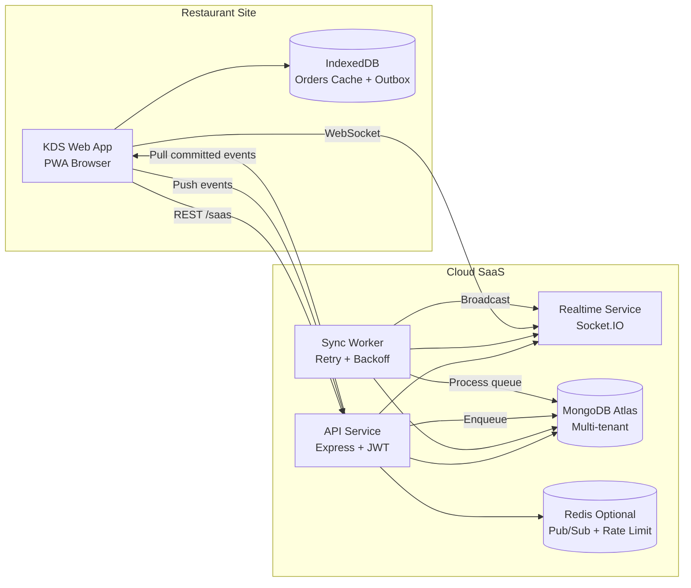

# KDS SaaS Cloud + Offline Architecture

## 1. High-Level Architecture



## 2. Service Responsibilities

- Cloud API
  - Tenant onboarding, auth, refresh token, CRUD de pedidos.
  - Endpoint bidirecional de sync (`/saas/sync/push`, `/saas/sync/pull`).
  - Isolamento por tenant via `tenantId` obrigatório.
- Realtime Gateway (Socket.IO)
  - Broadcast por room `tenant:{tenantId}`.
  - Entrega de eventos instantâneos de pedidos.
- Sync Worker
  - Consome fila (`sync_events`) com retries exponenciais.
  - Garante consistência eventual sem perda em falhas transitórias.
- Local client cache
  - IndexedDB com stores `orders`, `outbox`, `meta`.
  - Suporte a offline-first + replay automático.

## 3. Multi-tenant Data Model (MongoDB)

Coleções principais:

- `tenants`
- `users`
- `orders`
- `refresh_tokens`
- `sync_events`

Regras:

- Toda query de negócio deve incluir `tenantId`.
- Índices compostos por tenant para evitar colisão entre empresas.
- Usuários e pedidos isolados por tenant.

## 4. Example Mongo Schemas

### Tenant

```js
{
  _id: ObjectId,
  name: 'Restaurante Centro',
  slug: 'restaurante-centro',
  plan: 'starter',
  status: 'active',
  createdAt: Date
}
```

### User

```js
{
  _id: ObjectId,
  tenantId: 'TENANT_ID',
  username: 'admin',
  passwordHash: 'bcrypt_hash',
  permissions: ['admin', 'kitchen', 'display'],
  createdAt: Date
}
```

### Order

```js
{
  _id: ObjectId,
  tenantId: 'TENANT_ID',
  id: 'ORDER_PUBLIC_ID',
  number: 184,
  status: 'preparing',
  items: [{ name: 'Burger', quantity: 1 }],
  syncVersion: 3,
  createdAt: 1711000000000,
  updatedAt: 1711000100000,
  lastSyncedAt: 1711000100000
}
```

### SyncEvent (Queue)

```js
{
  _id: ObjectId,
  tenantId: 'TENANT_ID',
  source: 'device',
  deviceId: 'TABLET-01',
  eventType: 'order.updated.status',
  entityId: 'ORDER_PUBLIC_ID',
  clientMutationId: 'uuid',
  payload: { status: 'ready', syncVersion: 3 },
  status: 'pending',
  retries: 0,
  nextRetryAt: Date,
  committedAt: null,
  createdAt: Date
}
```

## 5. Bidirectional Sync Flow

### Device -> Cloud (push)

1. Operador altera status no KDS.
2. Mudança é aplicada localmente e salva no `outbox` (IndexedDB).
3. Cliente envia lote para `/saas/sync/push` quando online.
4. API persiste na fila (`sync_events`) com `status=pending`.
5. Worker processa, aplica no `orders`, marca `processed` e emite socket.

### Cloud -> Device (pull + realtime)

1. Cliente recebe evento instantâneo via Socket.IO na room do tenant.
2. Em reconexão, chama `/saas/sync/pull?since=<timestamp>`.
3. API retorna eventos processados após o timestamp.
4. Cliente reconcilia cache local e atualiza `lastPullAt`.

## 6. Queue + Retry Strategy

- Fila durável: coleção Mongo `sync_events`.
- Retry exponencial: `2^retries * 500ms` (máx 30s).
- Limite de tentativas: 8.
- Idempotência: índice único por `(tenantId, clientMutationId)`.

## 7. Security Baseline

- JWT access token curto (15 min).
- Refresh token persistido com hash SHA-256.
- Middleware valida claim `tenantId`.
- Rate limit em login/refresh/onboarding.
- Recomendado em produção:
  - TLS em todo tráfego.
  - KMS para segredos.
  - Criptografia de campos sensíveis (PII) em repouso.
  - Auditoria de acesso por tenant.

## 8. Suggested Production Stack

- Runtime: Node.js 22 + Express (migração futura para NestJS opcional).
- Banco: MongoDB Atlas (sharded para alto volume).
- Queue/Realtime scale: Redis + Socket.IO adapter.
- Infra: Railway para MVP; AWS ECS/Fargate para escala.
- Observabilidade: OpenTelemetry + Grafana/Loki.
- CI/CD: GitHub Actions com testes + deploy blue/green.

## 9. Suggested Folder Structure

```txt
server/
  index.js
  mongo.js
  models/
    Tenant.js
    User.js
    Order.js
    RefreshToken.js
    SyncEvent.js
  saas/
    auth.js
    tenant.js
    routes.js
    syncWorker.js
src/
  lib/
    offlineSync.ts
docs/
  saas-architecture.md
```

## 10. Distribution Model (SaaS)

- Tenant por subdomínio: `cliente.seudominio.com`.
- Fallback para header `x-tenant-id` em apps internos/white-label.
- Sem instalação pesada: acesso web + cache local para operação em internet instável.

## 11. Scale Roadmap

- Separar processos em 3 deploys:
  - API REST
  - WebSocket Gateway
  - Sync Worker
- Adicionar particionamento por tenantId e métricas por fila.
- Implementar analytics pipeline para dashboard (tempo médio, pedidos/hora, ranking de equipe).
